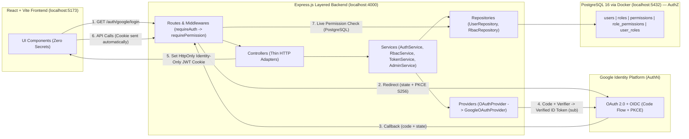

# Google OAuth 2.0 + PostgreSQL RBAC Demo

An enterprise-structured **Authentication (Google OAuth 2.0 + PKCE)** and **Authorization (Database-Driven PostgreSQL RBAC)** web application built with **React (Vite)**, **Node.js + Express.js**, and **PostgreSQL 16 (Docker)**.

---

## 1. Architecture Overview

The system strictly separates **Authentication (AuthN)** from **Authorization (AuthZ)**:

- **Authentication (Google OAuth 2.0 — Authorization Code Flow + PKCE):** Proves *who* the user is using Google's cryptographically verified ID token (keyed by immutable `google_sub`, never mutable email). The backend issues an **identity-only JWT (`sub: user.id`)** stored in an `HttpOnly`, `SameSite=Lax` cookie — zero secrets or tokens ever touch browser JavaScript or `localStorage`.
- **Authorization (Local 5-Table PostgreSQL RBAC):** Decides *what* the user can do by resolving atomic permission slugs (`student_area:access`, `admin_area:access`, `users:manage_roles`) **live from PostgreSQL on every request**. Because roles and permissions are never embedded in the JWT, role changes take effect immediately without re-login.



---

## 2. Layered Backend Architecture, SOLID Principles & LLD Patterns

All backend code lives under [`backend/src`](./backend/src) with strict separation of concerns:

| Layer | Directory | Responsibility |
| --- | --- | --- |
| **Config & DB** | `src/config/`, `src/db/` | Zod-validated immutable `AppConfig`, `Database` singleton pool with ACID transactions, idempotent `DatabaseInitializer` (`init.sql`). |
| **Domain Models** | `src/models/` | Domain entities/DTOs (`User`, `Role`, `Permission`, `AuthProfile`) and typed `AppError` hierarchy (`UnauthorizedError`, `ForbiddenError`, `NotFoundError`, `ValidationError`, `ConflictError`). |
| **Repositories** | `src/repositories/` | *Repository Pattern* — `UserRepository` & `RbacRepository` encapsulate 100% of parameterized SQL queries and concurrency-safe locking (`FOR UPDATE`). Zero SQL in services or controllers. |
| **OAuth Providers** | `src/providers/` | *Strategy Pattern* — Abstract `OAuthProvider` contract + `GoogleOAuthProvider`. Adding GitHub/Microsoft OAuth requires zero edits to `AuthService`. |
| **Services** | `src/services/` | Business logic (`AuthService`, `RbacService`, `TokenService`, `AdminService`) wired via constructor injection. Zero Express `req`/`res` objects. |
| **Middlewares** | `src/middlewares/` | *Factory + Chain of Responsibility* — `createAuthMiddleware`, `createPermissionMiddleware`, `createCsrfOriginMiddleware`, and centralized `errorHandler`. |
| **Controllers & Routes** | `src/controllers/`, `src/routes/` | Thin HTTP adapters + declarative middleware chains (`requireAuth` -> `requirePermission('...')`). Zero hardcoded `if (role === 'admin')`. |
| **Composition Root** | `src/container.js` | Wires `Config -> Database -> Repositories -> Providers -> Services -> Middlewares -> Controllers` in one place. |

### SOLID Highlights
- **Single Responsibility (S):** `TokenService` only handles JWT/PKCE crypto; `RbacService` only handles live permission resolution and role governance; `GoogleOAuthProvider` only speaks Google OAuth 2.0.
- **Open/Closed (O):** Extend authentication with new `OAuthProvider` strategies or add new permission slugs in PostgreSQL without modifying core guards.
- **Liskov Substitution (L):** Any `OAuthProvider` or `AppError` subclass is safely interchangeable at runtime.
- **Interface Segregation (I):** Focused repositories (`UserRepository` vs `RbacRepository`) and services (`AuthService` vs `AdminService`).
- **Dependency Inversion (D):** Services and controllers depend on injected abstractions wired in [`backend/src/container.js`](./backend/src/container.js).

---

## 3. Security Posture

- **No Secrets in Frontend:** The React app only knows `VITE_API_BASE_URL=http://localhost:4000`. All OAuth credentials, PKCE verifiers, and JWT secrets stay strictly server-side.
- **OAuth 2.0 + PKCE + CSRF State:** Uses `S256` PKCE, cryptographic `state` verified with `crypto.timingSafeEqual`, and single-use `HttpOnly` flow cookies scoped to `/auth/google/callback`.
- **Identity-Only `HttpOnly` JWT:** Signed with pinned `HS256` algorithm and contains only `sub: user.id` (no roles/permissions). Protected against XSS token theft and stale privilege escalation.
- **Fail-Closed RBAC:** Every protected route checks atomic permission slugs against PostgreSQL. Missing auth returns `401 Unauthorized`; missing permission returns `403 Forbidden` with `{ error: "FORBIDDEN", required_permission }`.
- **Transactional Last-Admin Lockout Protection:** `RbacRepository.replaceUserRole` locks the `admin` role row (`SELECT ... FOR UPDATE`) inside a PostgreSQL transaction to prevent demoting the last remaining admin even under concurrent requests.

---

## 4. Google Cloud Console OAuth 2.0 Setup

1. Go to [Google Cloud Console](https://console.cloud.google.com/) and create (or select) a project.
2. Navigate to **APIs & Services -> OAuth consent screen**:
   - Choose **External** (or Internal for Workspace).
   - Fill in App Name, User Support Email, and Developer Contact Email.
   - Under **Scopes**, ensure `openid`, `email`, and `profile` are included.
   - Under **Test users** (while in Testing mode), add the Gmail address(es) you will use to log in during the demo.
3. Navigate to **APIs & Services -> Credentials -> Create Credentials -> OAuth client ID**:
   - Application type: **Web application**.
   - **Authorized JavaScript origins:**
     - `http://localhost:5173`
     - `http://localhost:4000`
   - **Authorized redirect URIs:**
     - `http://localhost:4000/auth/google/callback`
4. Copy the generated **Client ID** and **Client Secret** into `backend/.env` (never commit `.env`).

---

## 5. Local Startup (Quick Setup for Evaluators)

### Prerequisites
- Docker Desktop (running)
- Node.js `>= 20`

### Step 1: Clone the Repo & Start PostgreSQL via Docker
```bash
git clone https://github.com/VarZ-96/Distributed-Systems-Project.git
cd Distributed-Systems-Project
docker compose up -d
```

### Step 2: Configure & Start the Backend (`localhost:4000`)
```bash
cd backend
cp .env.example .env
# Edit backend/.env and fill in:
#   GOOGLE_CLIENT_ID
#   GOOGLE_CLIENT_SECRET
#   JWT_SECRET  (run: node -e "console.log(require('crypto').randomBytes(48).toString('hex'))")
#   ADMIN_EMAILS (comma-separated Google email(s) to bootstrap as admin)

npm install
npm run dev
```
> On startup, `DatabaseInitializer` automatically runs `src/db/init.sql` idempotently (`ON CONFLICT DO NOTHING`) to create all 5 RBAC tables and seed roles/permissions.

### Step 3: Start the React Frontend (`localhost:5173`)
In a second terminal:
```bash
cd frontend
npm install
npm run dev
```
Open **http://localhost:5173** in your browser.

---

## 6. API Endpoints

| Method | Endpoint | Guard | Description |
| --- | --- | --- | --- |
| `GET` | `/health` | Public | Health check including PostgreSQL connectivity |
| `GET` | `/auth/google/login` | Public | Starts Google OAuth 2.0 flow with CSRF `state` + PKCE `S256` cookies |
| `GET` | `/auth/google/callback` | Public | Validates state/PKCE, verifies Google ID token, upserts user, sets `HttpOnly` JWT |
| `POST` | `/auth/logout` | Public | Clears the `HttpOnly` auth cookie |
| `GET` | `/api/me` | `requireAuth` | Returns current user profile, assigned roles, and live permission slugs |
| `GET` | `/student-area` | `requireAuth`, `requirePermission("student_area:access")` | Student dashboard payload (`200 OK`) |
| `GET` | `/admin-area` | `requireAuth`, `requirePermission("admin_area:access")` | Admin dashboard payload (`200 OK` / `403 Forbidden`) |
| `GET` | `/api/admin/users` | `requireAuth`, `requirePermission("users:manage_roles")` | Lists all users with roles & effective permissions |
| `PATCH` | `/api/admin/users/:id/role` | `requireAuth`, `requirePermission("users:manage_roles")` | Updates a user's role (`student` / `admin`) with last-admin lockout protection |

---

## 7. Quick Demo Walkthrough (<= 5 Minutes)

1. **Logged Out (`401 Unauthorized`):** Click both **Call `/student-area`** and **Call `/admin-area`** -> both return `401 Unauthorized`.
2. **Student Login (`200` / `403`):** Click **Login with Google** using a non-admin account -> automatically assigned `student` (least privilege).
   - `GET /student-area` -> **`200 OK`**
   - `GET /admin-area` -> **`403 Forbidden`** with `{ "error": "FORBIDDEN", "required_permission": "admin_area:access" }`
3. **Admin Login & Live Role Switch (`200` / `200`):** Log in as an `ADMIN_EMAILS` account -> **Admin Role Manager** appears automatically (`users:manage_roles`).
   - Both `/student-area` and `/admin-area` return **`200 OK`**.
   - Try demoting the sole admin -> blocked with **`409 Conflict`** (last-admin lockout protection).
   - Promote the student account to `admin` -> permissions apply immediately without re-login.

## 8. Running Backend Unit Tests
```bash
cd backend
npm test
```
